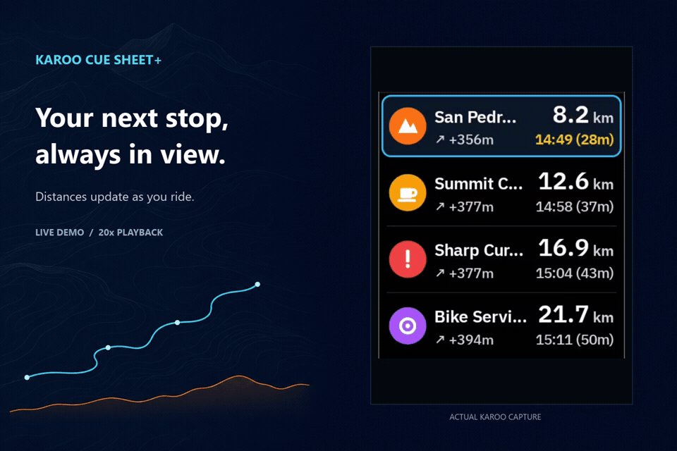

<p align="center">
  
</p>

# Karoo Cue Sheet+

[](https://github.com/apopovsky/KarooCueSheetPlus/actions/workflows/ci.yml)
[](https://www.hammerhead.io/)
[](LICENSE)

An enhanced **Cue Sheet** extension for **Hammerhead Karoo 3**. 

Designed to bring the Garmin Course Points list experience to Karoo with clean high-contrast typography, interactive touch details, auto-detected terrain envelopes (Road, Gravel, MTB), and distance- and VAM-weighted gradient ETA extrapolation.

<p align="center">
  
</p>

<p align="center">
  
  &nbsp;
  
</p>

---

## Features

- **Full-Page View (480×800):**
  - High-visibility 5-row window with large typography.
  - Auto-follows your ride progression, showing upcoming Waypoints, POIs, and Summits while cleanly marking passed points.
  - Auto-pins the route Finish point at the bottom row.
  - Supports manual scrolling (touch ▲ / ▼ buttons) with auto-return timeout.
  - Interactive touch on any row displays a full-screen Detail Card with an elevation sparkline profile, distance to go, elevation gain/loss, and gradient-aware ETA.
- **Adaptive Shared-Page Rendering:**
  - **Half-Page View (full width):** Automatically switches to a simplified 2–3 row layout with larger, legible typography when sharing a data page.
  - **Compact / Single-Field Fallback:** Narrow or single-row cells automatically fall back to the compact Next Waypoint layout.
- **Single-Field Data View (1 Field / Half-Row / Wide-Row):**
  - Ultra-clean display of the next upcoming waypoint name, category badge, remaining distance, and live ETA.
- **Physics-Consistent Terrain & VAM ETA Engine:**
  - Zero-config auto-detection from Karoo's `ActiveRideProfile` (*Road*, *Gravel*, *MTB*, *MTB Technical*).
  - Backward-looking cumulative pace: averages actual ridden distance & time on flats (`V_llano`) and vertical ascent & time on climbs (`VAM`) with long rolling memory.
  - Unaffected by instantaneous power changes, drafting in a peloton, short anaerobic sprints, or a 50-meter river ford.
  - Adapts smoothly to fatigue, wind, and degrading conditions (such as rain turning gravel to mud).
- **Multilingual Support:**
  - Auto-adapts to device language: English, Spanish, Portuguese, French, Italian, and German, with universal fallback to English.

---

## Installation

Download the latest APK from:

https://github.com/apopovsky/KarooCueSheetPlus/releases/latest

### Via Hammerhead Companion App (Recommended)

1. Open the latest release page on your smartphone (or copy `https://github.com/apopovsky/KarooCueSheetPlus/releases/latest/download/manifest.json`).
2. Share the `manifest.json` URL (or `KarooCueSheetPlus-vX.X.X-release.apk` link) to **Hammerhead Companion App**.
3. Confirm installation when prompted on your Karoo 3. Future updates can be installed directly from **Extensions** on the Karoo.

### Via ADB

```bash
adb install -r KarooCueSheetPlus-v1.0.4-release.apk
```

---

## Requirements

- Hammerhead Karoo 3 (or Karoo OS 1.634.2440+ with sideloading enabled).
- An active route loaded with Waypoints / POIs / Climbs.

---

## Build from Source

```bash
git clone https://github.com/apopovsky/KarooCueSheetPlus.git
cd KarooCueSheetPlus

# Run unit tests and assemble debug builds
./gradlew :shared:testDebugUnitTest :app:assembleDebug :simulator:assembleDebug
```

---

## Local Simulator

The repository includes a companion `:simulator` module replicating Karoo 3 glance field rendering and navigation telemetry on a standard Android emulator or device without needing physical Karoo hardware or KOS services.

### Prerequisites

1. **JDK 17** and **Android SDK** (`compileSdk 37` / `targetSdk 35`), with `sdk.dir` configured in `local.properties`.
2. **GitHub Packages credentials** (`gpr.user` and `gpr.key` in `gradle.properties`, or `USERNAME` and `TOKEN` environment variables) with `read:packages` scope to resolve `io.hammerhead:karoo-ext`.
3. **Sibling `KarooExtensionSimulator` project** cloned at `../KarooExtensionSimulator` (alongside `KarooCueSheetPlus`). `settings.gradle.kts` automatically detects `../KarooExtensionSimulator` to include `:simulator` and substitute `com.itl.karoo:core` via composite build; if absent, `:simulator` is omitted so `:shared` and `:app` still build standalone.
4. **Android Emulator (AVD) or connected Android device:** `run_simulator.cmd` checks for an active ADB target and, if none is running, launches the `Medium_Phone_API_35` AVD from `%LOCALAPPDATA%\Android\Sdk\emulator\emulator.exe`.

### Build & Run

```bash
# Build the simulator debug APK
./gradlew :simulator:assembleDebug

# Windows helper: boots Medium_Phone_API_35 if needed, installs simulator-debug.apk, and launches CueSheetSimulatorActivity
run_simulator.cmd
```

### Capabilities

- Preloaded with a bundled 85 km MTB route (*Desafío Río Pinto 2022*, `COURSE_97867009.gpx`) plus a file picker (`📂 Load GPX`) to test any custom `.gpx` route.
- Emulates Karoo 3 screen layouts (Full-Screen, Wide row, Half-row, Compact), time-warp playback (`1x`, `5x`, `20x`, `60x`), rider power (W), surface profiles (*Road*, *Gravel*, *MTB*, *MTB Technical*), Day/Night themes, route position scrubber, and interactive touch buttons (`▲`, `▼`, and row detail card).

---

## License

Licensed under the [Apache License, Version 2.0](LICENSE).
