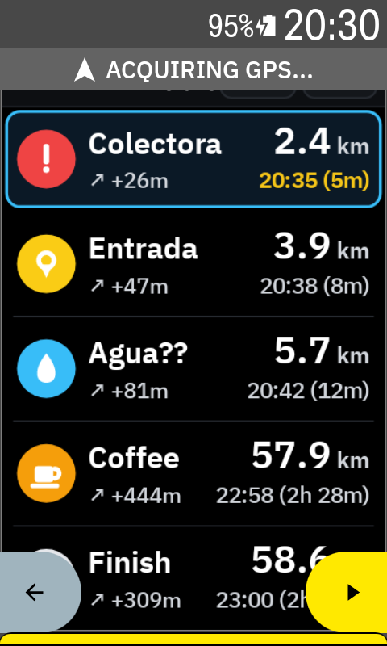
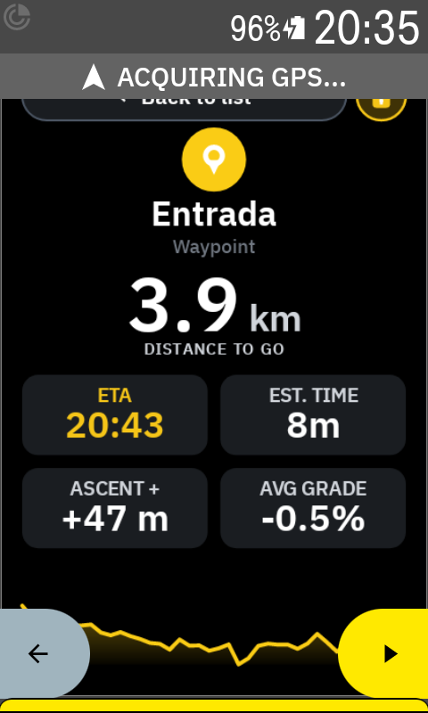

<p align="center">
  
</p>

# Karoo Cue Sheet+

[](https://github.com/apopovsky/KarooCueSheetPlus/actions/workflows/ci.yml)
[](https://www.hammerhead.io/)
[](LICENSE)

An enhanced **Cue Sheet** extension for **Hammerhead Karoo 3**. 

Designed to bring the Garmin Course Points list experience to Karoo with clean high-contrast typography, interactive touch details, auto-detected terrain envelopes (Road, Gravel, MTB), and distance- and VAM-weighted gradient ETA extrapolation.

<p align="center">
  
  &nbsp;&nbsp;&nbsp;&nbsp;
  
</p>

---

## Features

- **Full-Page View (480×800):**
  - High-visibility 5-row window with large typography.
  - Auto-follows your ride progression, showing upcoming Waypoints, POIs, and Summits while cleanly marking passed points.
  - Auto-pins the route Finish point at the bottom row.
  - Supports manual scrolling (touch ▲ / ▼ buttons) with auto-return timeout.
  - Interactive touch on any row displays a full-screen Detail Card with an elevation sparkline profile, distance to go, elevation gain/loss, and gradient-aware ETA.
- **Single-Field Data View (1 Field / Half-Row / Wide-Row):**
  - Ultra-clean display of the next upcoming waypoint name, category badge, and remaining distance.
- **Physics-Consistent Terrain & VAM ETA Engine:**
  - Zero-config auto-detection from Karoo's `ActiveRideProfile` (*Road*, *Gravel*, *MTB*, *MTB Technical*).
  - Backward-looking cumulative pace: averages actual ridden distance & time on flats (`V_llano`) and vertical ascent & time on climbs (`VAM`) with long rolling memory.
  - Unaffected by instantaneous power changes, drafting in a peloton, short anaerobic sprints, or a 50-meter river ford.
  - Adapts smoothly to fatigue, wind, and degrading conditions (such as rain turning gravel to mud).
- **Multilingual Support:**
  - Auto-adapts to device language: English, Spanish, Portuguese, French, Italian, and German, with universal fallback to English.

---

## Installation

Download the latest APK from:

https://github.com/apopovsky/KarooCueSheetPlus/releases/latest

### Via Hammerhead Companion App (Recommended)

1. Open the latest release page on your smartphone.
2. Download or share the `KarooCueSheetPlus-vX.X.X-release.apk` link.
3. Select **Hammerhead Companion App**.
4. Confirm installation when prompted on your Karoo 3.

### Via ADB

```bash
adb install -r KarooCueSheetPlus-v1.0.1-release.apk
```

---

## Requirements

- Hammerhead Karoo 3 (or Karoo OS 1.634.2440+ with sideloading enabled).
- An active route loaded with Waypoints / POIs / Climbs.

---

## Build from Source

```bash
git clone https://github.com/apopovsky/KarooCueSheetPlus.git
cd KarooCueSheetPlus

# Run unit tests and assemble debug builds
./gradlew :shared:testDebugUnitTest :app:assembleDebug :simulator:assembleDebug
```

---

## Local Simulator

The repository includes a companion `:simulator` module replicating Karoo 3 glance field rendering and navigation telemetry for desktop testing without needing physical hardware.

On Windows:
```cmd
run_simulator.cmd
```

---

## License

Licensed under the [Apache License, Version 2.0](LICENSE).
